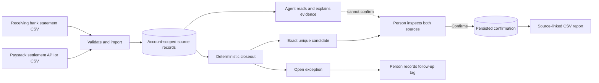

# Tillmatch

### Close the loop between a Paystack payout and the money credited to the bank.

Tillmatch is a payout closeout workspace for merchants and finance operators. It brings Paystack settlement records and bank statement credits into one review flow, shows the source evidence behind each result, and keeps a person responsible for confirming a match.

**The problem:** payout reconciliation is often a manual comparison between one provider's settlement report and another institution's bank statement. The records use different references and arrive at different times. An exact match is straightforward; a delayed, ambiguous, partial, or batched deposit needs investigation. A spreadsheet can show matching amounts, but it does not by itself preserve why a match was proposed or who accepted it.

**The solution:** Tillmatch imports both sides, applies a conservative deterministic rule, records its source and outcome, and leaves uncertain rows open. It never moves money and never treats an AI response as financial approval.

## How a closeout works



1. **Sign in and select an environment.** The closeout desk is private. Choose the Paystack test or live environment so settlement records remain clearly labeled.
2. **Import the provider side.** Read the merchant's Paystack settlements for a date range using a server-side read-only request, or upload an actual settlement export. CSV columns for settlement ID, date, amount, currency, and status are mapped explicitly; the amount unit is selected explicitly too.
3. **Import the bank side.** Upload the statement from the account that receives the payouts. Map the posted date, credit amount, and currency. The parser accepts positive credits and reports malformed or unsupported values instead of silently guessing.
4. **Run closeout.** Tillmatch compares exact integer minor-unit amounts and currency codes. By default, a bank credit must be within three calendar days of the settlement date. The candidate must be unique in both directions: one settlement to one bank credit.
5. **Inspect the evidence.** The result shows the settlement source ID or source row, bank statement row, dates, amount, currency, status, and the reason for the decision. Ambiguous, invalid, non-settled, unmatched, partial, and many-to-one cases stay open. Fees, splits, and batched deposits are not inferred from amount alone.
6. **Make and preserve the decision.** A signed-in person can confirm an exact candidate after reviewing both sources. Confirmation revalidates the current source rows, prevents reusing a settlement or bank credit, records who confirmed and when, then reads the persisted result back. Open exceptions can receive a follow-up tag without being marked resolved.
7. **Export the closeout.** Download a CSV with source references, source hashes where available, result status, review tag, and reason.

## What makes the workflow careful

- **Evidence before status.** A candidate links to the records that support it; the system does not manufacture a match when evidence is missing.
- **Deterministic matching.** The match rule is inspectable and repeatable: exact currency, exact minor-unit amount, unique one-to-one candidate, and a bounded date window.
- **Human confirmation.** A candidate is only a suggestion. The confirmation action is UI-only, rechecks uniqueness, rejects stale or already-used rows, and persists reviewer identity and time.
- **Account boundaries.** Source rows, closeout runs, and review actions are queried using the signed-in account identity. Unauthenticated requests to protected actions are rejected.
- **Minimal imported data.** CSV files are parsed in memory and not retained as uploaded files. The app stores fields needed for comparison and source provenance, not raw CSV, bank narration, account numbers, or customer names. Paystack credentials remain on the server.
- **Safe failure.** Invalid data, missing configuration, a provider error, duplicate import, stale candidate, or absent source rows is surfaced as an error or open state—not as a success-shaped result.

## Agent-Native and AI

Tillmatch is built with **Agent-Native `@agent-native/core` 0.222.2**. Agent-Native provides the application runtime, authenticated typed actions, and the agent workspace. Tillmatch's product actions connect those capabilities to source import, Paystack reads, closeout, review, and report workflows.

The reconciliation decision itself is deterministic TypeScript logic. The agent's role is to read persisted closeout evidence and explain what it supports. It must distinguish a candidate from a person-confirmed result, and it cannot call the confirmation or exception-review actions. This gives the user a conversational way to inspect the work without handing financial approval to a model.

## Built for the Agent-Native Hackathon

Tillmatch is a functional application built on the Agent-Native framework for the **Agent-Native Hackathon, sponsored by Builder.io**. It applies the hackathon's people-and-agent workflow to a concrete finance task: the app performs the source-grounded comparison, the agent can explain the evidence, and the person owns the consequential decision.

The project-specific implementation includes the public Tillmatch landing page, separate authenticated closeout dashboard, Paystack settlement reader, strict CSV import and explicit field mapping, account-scoped persistence, exact-match engine, exception review, human confirmation, and source-linked export. The app uses the Agent-Native chat template and its framework components alongside Tillmatch-specific routes and actions.

The official hackathon requires a functional Agent-Native app and a **public Clips recording viewable without login**. A public repository and hosted deployment are encouraged. Submission also requires project and creator/team details, eligibility and rules confirmations, and confirmation that the form submission was received. This repository does not claim that the Clip or entry has been submitted.

## Demo

The public page is `/`. The signed-in closeout desk is `/dashboard`; the agent workspace is `/chat`.

For a full data-backed walkthrough, use authorized Paystack settlement records and the corresponding real bank statement. The flow is: import/read both sources → run closeout → inspect the proposed match and unresolved rows → confirm only after checking the sources → reload and show the saved confirmation → export the report.

The developer currently has access to Paystack test mode only. Paystack test mode does not process settlements, so a test key cannot produce a genuine payout-to-bank reconciliation. Until authorized real settlement and bank records are available, the honest demo is the hosted product, authenticated empty state, and the source review workflow; no live match should be claimed. The app includes no seeded merchant transactions. Its small synthetic CSV fixture is isolated under `test/fixtures/` for parser tests and is never loaded by the product.

An agent response is optional for the test-only walkthrough; the closeout workflow does not require a model credential. If you choose to show an agent response, configure a supported model provider and show its actual output. A prompt suitable for an empty workspace is:

> Using only the records available in this workspace, tell me whether any Paystack settlement has a matching bank credit. If no records are loaded, say that no conclusion is possible. Do not invent records or confirm a match.

Skip that segment if the model provider is unavailable; the app can be demonstrated without presenting an unverified model response.

## Technology

- Agent-Native `@agent-native/core` 0.222.2 and Agent-Native Toolkit
- React 19 and React Router 8 in framework mode
- TypeScript for typed framework actions; JavaScript modules for CSV, matching, and Paystack client logic
- Drizzle ORM with PostgreSQL for hosted persistence; Agent-Native development storage for local work
- Paystack settlement list API, accessed server-side with read-only `GET` requests
- Node.js 22.22+ and pnpm 10.29.1

## Run locally

```powershell
corepack enable
pnpm install --frozen-lockfile
pnpm dev -- --host 127.0.0.1
```

Open the local URL printed by the development server. Local development storage and local development authentication are for development only; they do not represent a production account or deployment.

To run the local PostgreSQL Compose stack with generated local-only credentials:

```powershell
./scripts/prepare-docker-env.ps1
docker compose --env-file .env.docker up --build
```

The generated `.env.docker` file is local-only and ignored by Git. Do not copy local Compose credentials or data into a hosted deployment.

## Run checks

```powershell
pnpm typecheck
node test/run.mjs
node scripts/verify-http.mjs http://127.0.0.1:3000
```

The isolated tests cover CSV parsing and validation, matching outcomes, Paystack key/environment validation, and the Paystack client request contract. They do not make a real Paystack request or verify a model provider. The HTTP script checks route responses and selected page content; HTTP 200 does not prove browser interaction, signed-in access, or a successful data workflow.

## Deploy to Render

`render.yaml` defines the Node web service and a PostgreSQL database in the **Frankfurt region**, plus the Render Nitro build/start commands and `/dashboard` health check. Create the Render service using **New → Blueprint** and select this repository. Render provisions the database and injects its private internal connection string into the web service as `DATABASE_URL`; you do not need to create or paste a database URL yourself. The web service and database use the same region, so they can communicate over Render's private network. Render documents Blueprint database references in its [Blueprint specification](https://render.com/docs/blueprint-spec) and database connections in the [Postgres connection guide](https://render.com/docs/postgresql-creating-connecting).

The Blueprint uses Render's Free Postgres plan. Free databases expire 30 days after creation; upgrade the database if you need the hosted data to remain available beyond that period. [Render Free plan limits](https://render.com/docs/free).

Configure these values in Render's service environment:

| Variable | Configuration |
| --- | --- |
| `DATABASE_URL` | Automatically set from the Blueprint-created PostgreSQL database |
| `BETTER_AUTH_SECRET` | Automatically generated by Render and kept stable across deploys |
| `PAYSTACK_SECRET_KEY` | Enter your Paystack `sk_test_...` key when Render prompts for the secret |
| `PAYSTACK_ENVIRONMENT` | Set to `test` by the Blueprint; it matches your current test key |

The Paystack test secret is the only application secret you need to enter for the current build. Keep it in Render's secret settings and out of GitHub, the browser, and screen recordings. The closeout workflow does not require a model-provider credential.

On Render, leave `APP_URL` and `BETTER_AUTH_URL` unset so the public origin can be inferred. Keep production authentication enabled. Never commit secrets or enter them in a browser field, chat prompt, README, or recording. After deploying, check `/`, `/landing`, `/dashboard`, and `/chat`; then sign in and verify the authenticated dashboard and its real data state.

## Project map

| Path | Purpose |
| --- | --- |
| `app/routes/landing.tsx` | Public Tillmatch product page |
| `app/routes/dashboard.tsx` | Closeout dashboard, CSV mapping, review, and export |
| `actions/actions/` | Authenticated application operations and agent-tool permissions |
| `src/csv.mjs` | Strict CSV parsing and amount/date normalization |
| `src/matcher.mjs` | Deterministic exact, unique one-to-one match logic |
| `src/paystack.mjs` | Read-only Paystack settlement API client |
| `server/server/db/schema.ts` | Persisted source records, runs, results, and confirmations |
| `test/` | Isolated parser, matcher, and Paystack client tests |
| `render.yaml` | Render service configuration |

## References

- [Agent-Native Hackathon official rules](https://www.builder.io/hackathon/rules)
- [Agent-Native documentation](https://www.agent-native.com/docs/)
- [Agent-Native Docker guide](https://www.agent-native.com/docs/docker/)
- [Paystack API authentication and test/live modes](https://paystack.com/docs/api/authentication/)
- [Paystack settlement API](https://paystack.com/docs/api/settlement/)

Check the official rules at submission time for current dates, eligibility, required information, and form instructions. The published deadline is November 9, 2026 at 11:59 PM Pacific Time.
